

**English** | [Tiếng Việt](README.vi.md)

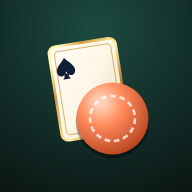

# Chain Five

**Play a card, drop a chip, make five in a row.**

A two-player card and board game for the browser. 
Invite a friend with a link, or take on the computer.

[**Play now**](https://pius-game-enter.github.io/chain-five/)

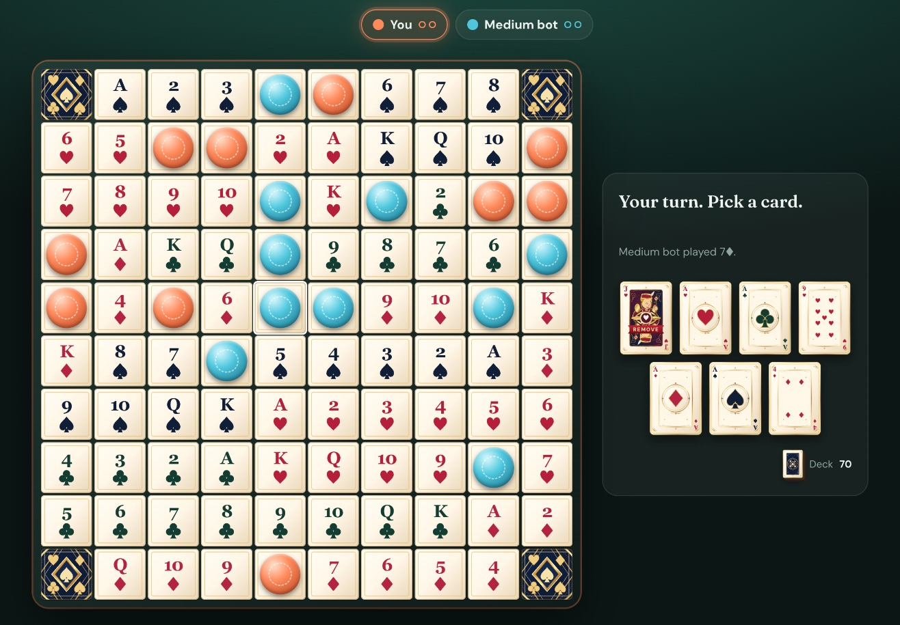

## Features

- **Play a friend online.** Create a room, send the link, and the game starts the moment they open it. No sign-up needed.
- **Play the computer.** Choose Easy, Medium or Hard. Works even without an internet connection.
- **Made for phones too.** Add it to your home screen and it plays like an app, upright or sideways.
- **A hand-designed deck.** 52 illustrated cards with their own card back.
- **Fair play.** Your opponent never sees your hand.
- **English and Vietnamese.** Switch any time with the EN/VI button. Each player sees the game in their own language.

## Screenshots

<table>
  <tr>
    <td align="center">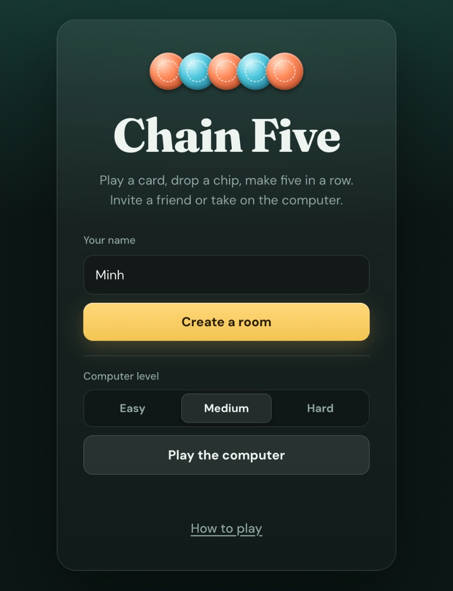 Start a game</td>
    <td align="center">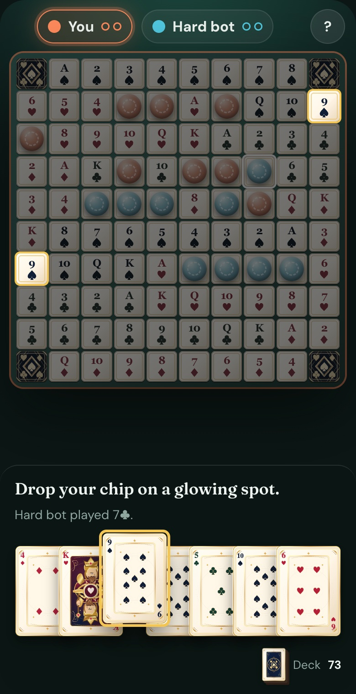 On a phone</td>
  </tr>
</table>

### The deck

  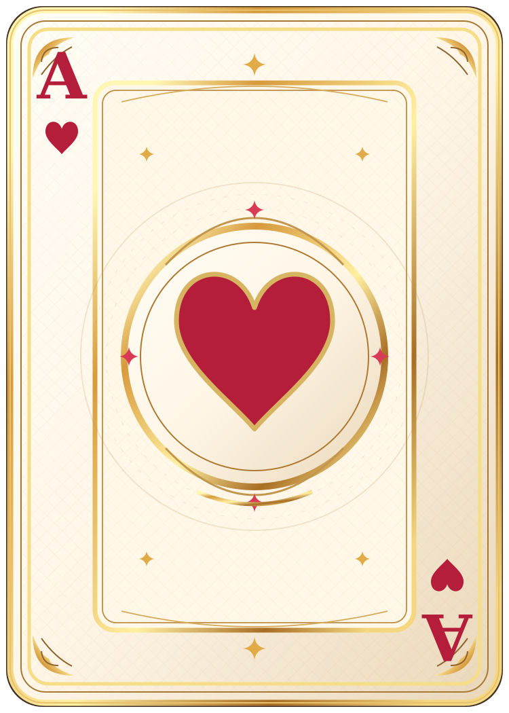
  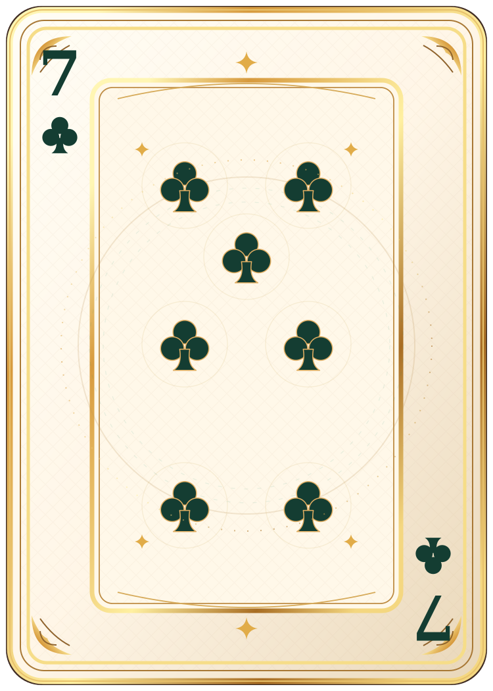
  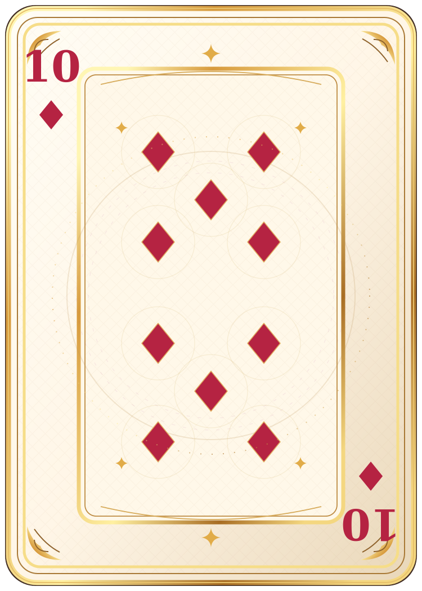
  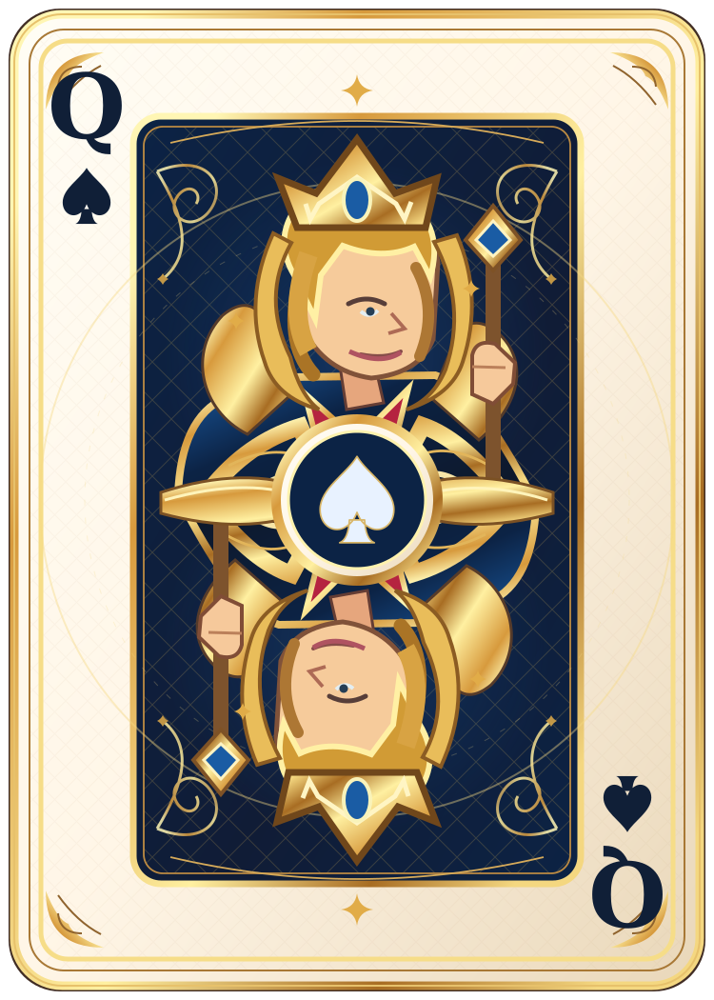
  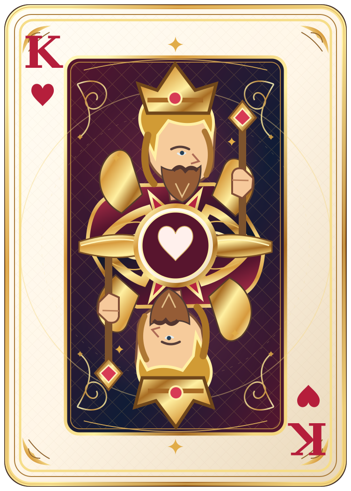
  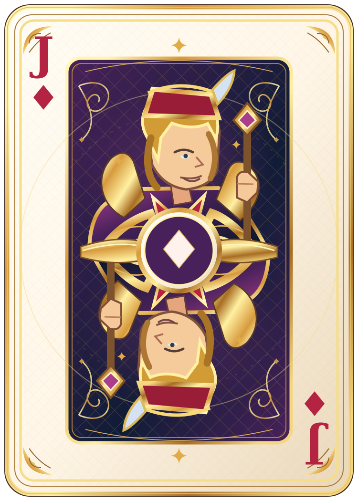
  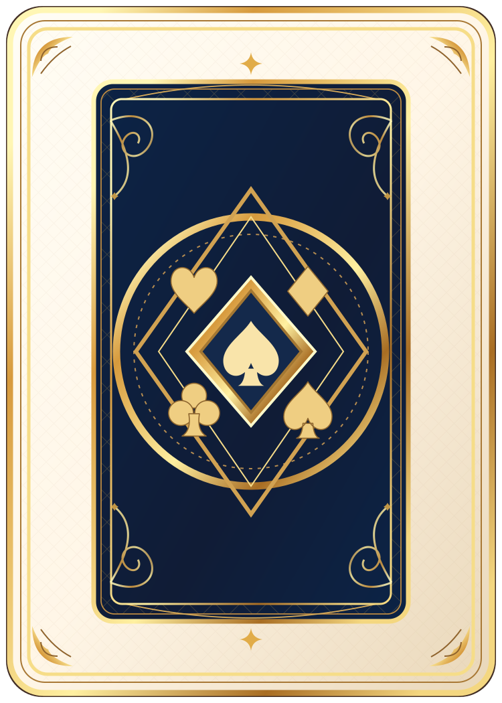

## How to play

1. On your turn, play a card from your hand and drop a chip on a matching card on the board. Every card except the jacks is on the board twice.
2. Five chips in a row, across, down or diagonally, make a **line**. **Two lines win.** Your second line may share one chip with your first.
3. The four corners are free spots that count for everyone.
4. **Wild jacks** (J♦ J♣) go on any open spot. **Remove jacks** (J♠ J♥) take away one of your opponent's chips, unless it is part of a finished line.
5. If both spots for a card are taken, the card is dead. Swap it for a new one without losing your turn.

The board is the same every game, laid out by suit and rank, so you can learn where every card is.

## Play on your phone

- **iPhone (Safari):** tap Share, then *Add to Home Screen*.
- **Android (Chrome):** open the menu, then *Install app*.

It then opens full screen from its own icon, and you can play the computer anywhere, even offline.

## Good to know

- Games are for two players.
- Reloaded or closed the page by accident? Open the game again in the same browser and it picks up where you left off, for both players. Use the back arrow to leave a game on purpose.
- The player who creates the room keeps the game on their device. If they leave on purpose, the game ends for both of you.
- Share your invite link only with the person you are playing.
- Some strict networks, such as certain school or office Wi-Fi, may block playing a friend online. Playing the computer always works.

## Credits

- Card art designed in Claude Design.
- Online play powered by [PeerJS](https://peerjs.com).
- Type set in [Fraunces](https://fonts.google.com/specimen/Fraunces) and [DM Sans](https://fonts.google.com/specimen/DM+Sans).

## License

[MIT](LICENSE)
