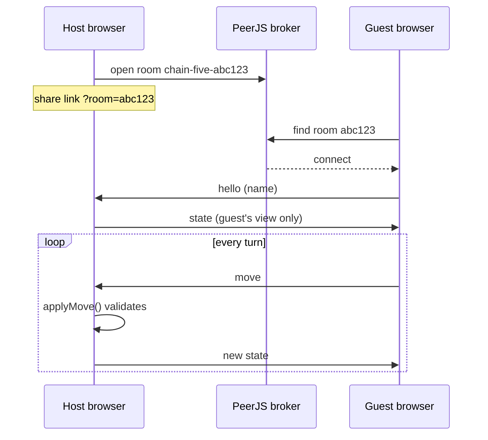

<div align="center">


# Chain Five

**Play a card, drop a chip, make five in a row.**

A two-player card and board game for the browser.<br>
Invite a friend with a link, or take on the computer.

[**Play now**](https://pius-game-enter.github.io/chain-five/)


</div>

## Features

- **Play a friend online.** Create a room, send the link, and the game starts when they open it. No accounts, no server of our own.
- **Play the computer.** Three levels (Easy, Medium, Hard), fully offline.
- **Built for phones.** Installs to the home screen, runs full screen, and has a fanned hand and a landscape layout.
- **A hand-designed deck.** 52 illustrated card faces and a card back, all vector.
- **Fair by construction.** The host checks every move against the rules, and each player only ever receives their own hand.

## Screenshots

<table>
  <tr>
    <td align="center"><br><sub>Lobby</sub></td>
    <td align="center"><br><sub>On a phone</sub></td>
  </tr>
</table>

### The deck

<p>
  
  
  
  
  
  
  
</p>

## How to play

1. On your turn, play a card from your hand and drop a chip on a matching card on the board. Every card except the jacks is on the board twice.
2. Five chips in a row, across, down or diagonally, make a **line**. **Two lines win.** Your second line may share one chip with your first.
3. The four corners are free spots that count for everyone.
4. **Wild jacks** (J♦ J♣) go on any open spot. **Remove jacks** (J♠ J♥) take away one of your opponent's chips, unless it is part of a finished line.
5. If both spots for a card are taken, the card is dead. Swap it for a new one without losing your turn.

The board is the same every game. The top half runs through every card once, by suit and rank, and the bottom half repeats it five rows down and mirrored, so the two copies of a card are never close together.

## How online play works

GitHub Pages only serves static files, so there is no game server. The two browsers connect directly over WebRTC using [PeerJS](https://peerjs.com), and the free PeerJS broker only introduces them.



The host's tab owns the real game. The guest only sends moves and draws the state that comes back, and that state never includes the host's hand or the deck order.

## The computer opponent

The bot scores every legal move by the five-cell windows it touches. It finishes its own line first, blocks one of yours next, then builds toward a line, and it saves jacks for moves that matter. It sees only the board and its own hand, never yours.

Tuning the scoring weights barely changed its strength, because card luck dominates. The levels therefore differ by how often the bot plays a random move instead of its best one.

| Level | Random moves | Blocks you | Measured over 2000 games |
|---|---|---|---|
| Easy | 50% | No | Beats random play 95% of the time |
| Medium | 20% | Yes | Beats Easy 66% |
| Hard | Never | Yes | Beats Medium 61%, Easy 74% |

## Install on a phone

Chain Five is a Progressive Web App, so there is no app store involved.

- **iPhone (Safari):** Share, then *Add to Home Screen*.
- **Android (Chrome):** menu, then *Install app*.

The service worker stores every file, all 53 cards included, so playing the computer works with no connection. Playing a friend still needs the network. While a game is on, the screen stays awake, because a sleeping phone drops the live connection.

## Project structure

```
index.html            screens and markup
style.css             all styling, including phone and landscape layouts
app.js                rendering, lobby, networking, computer turns
game.js               rules engine: pure functions over plain JSON
bot.js                computer opponent and difficulty levels
game.test.mjs         rules and bot checks
sw.js                 offline cache (network first)
manifest.webmanifest  install metadata
cards/                52 card faces and the card back (SVG)
icons/                app icons
docs/screenshots/     images for this README
```

No framework, no bundler, no dependencies to install. PeerJS and the fonts load from a CDN.

## Run locally

ES modules need a server, so `file://` will not work. From the repo root:

```sh
python3 -m http.server 8765
```

Then open http://localhost:8765/ in two tabs to play yourself, or use *Play the computer*.

## Tests

```sh
node game.test.mjs
```

This covers the deal, the fixed board, lines (including corners, diagonals and the shared-chip rule), both kinds of jack, dead cards and hidden hands. It also checks the bot: it must finish its own line, block yours, swap dead cards and play a whole game legally, and Hard must clearly beat Easy.

## Deploy

1. Settings, Pages, Source: *Deploy from a branch*, branch `main`, folder `/ (root)`.
2. The game goes live at https://pius-game-enter.github.io/chain-five/

The service worker is network first, so a new deploy reaches players on their next load and old and new files never mix. Bump `CACHE` in `sw.js` only to clear what phones have stored.

## Known limits

- Two players only.
- The hosted game lives in the host's tab. If the host closes it, the game ends. A guest who reloads can rejoin with the same link.
- Whoever opens an invite link last takes the guest seat, so share links only with the person you are playing.
- Rooms depend on the free PeerJS broker. On some strict networks a direct connection may fail.

## Credits

- Card faces and back designed in Claude Design.
- Networking by [PeerJS](https://peerjs.com).
- Type set in [Fraunces](https://fonts.google.com/specimen/Fraunces) and [DM Sans](https://fonts.google.com/specimen/DM+Sans).

## License

[MIT](LICENSE)
