

[English](README.md) | **Tiếng Việt**

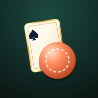

# Chain Five

**Đánh bài, đặt chip, xếp 5 ô thẳng hàng.**

Game bài kết hợp bàn cờ cho hai người, chơi ngay trên trình duyệt. 
Mời bạn bè bằng một đường link, hoặc đấu với máy.

[**Chơi ngay**](https://pius-game-enter.github.io/chain-five/)

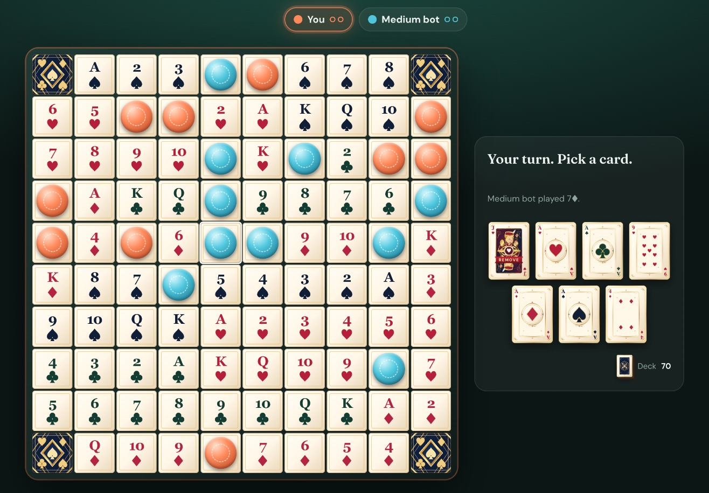

## Tính năng

- **Chơi online với bạn bè.** Tạo phòng, gửi link, ván đấu bắt đầu ngay khi bạn của bạn mở link. Không cần đăng ký.
- **Chơi với máy.** Chọn Dễ, Vừa hoặc Khó. Chơi được cả khi không có mạng.
- **Chơi tốt trên điện thoại.** Thêm vào màn hình chính là dùng như một ứng dụng, cầm dọc hay xoay ngang đều được.
- **Bộ bài vẽ riêng.** 52 lá bài minh họa cùng mặt sau riêng.
- **Công bằng.** Đối thủ không bao giờ thấy bài trên tay bạn.
- **Tiếng Việt và tiếng Anh.** Đổi bất cứ lúc nào bằng nút EN/VI. Mỗi người chơi thấy game bằng ngôn ngữ của mình.

## Hình ảnh

<table>
  <tr>
    <td align="center">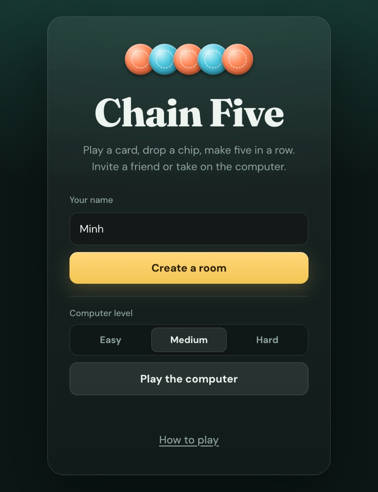 Bắt đầu ván</td>
    <td align="center">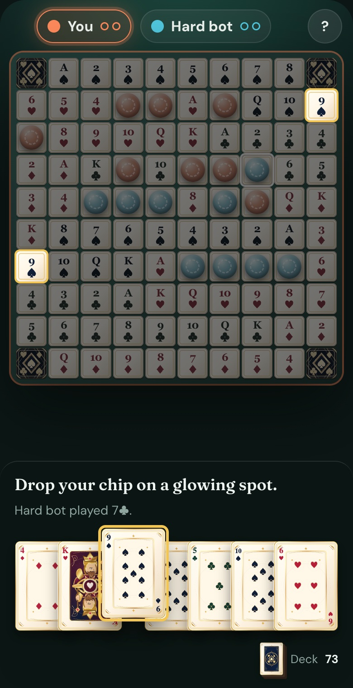 Trên điện thoại</td>
  </tr>
</table>

### Bộ bài

  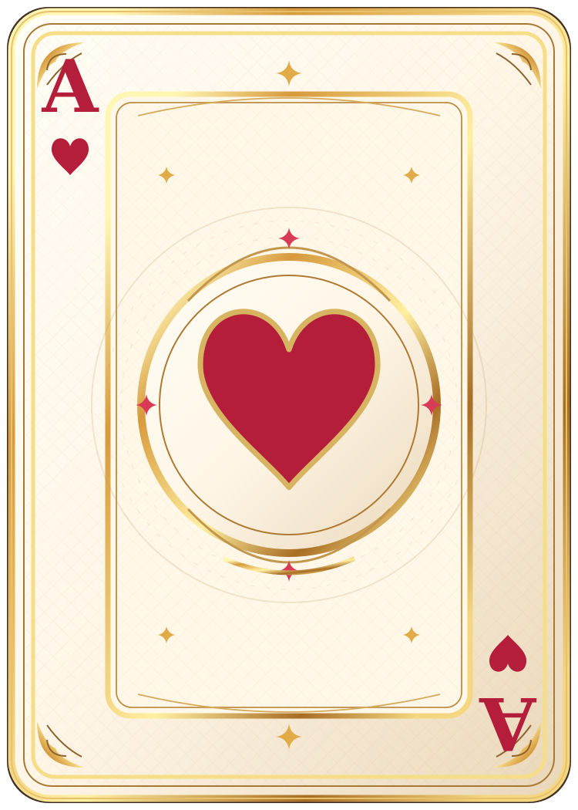
  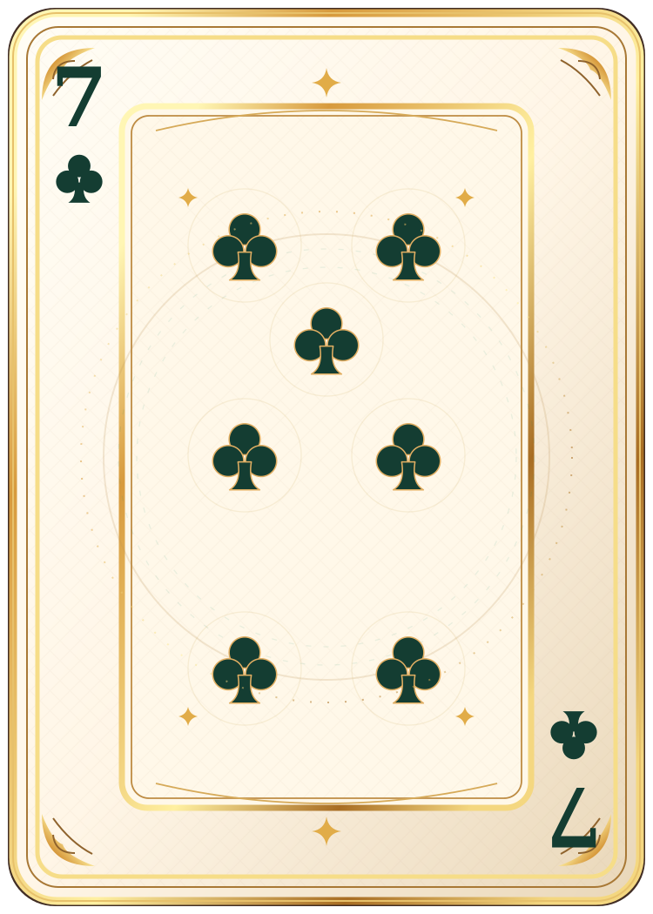
  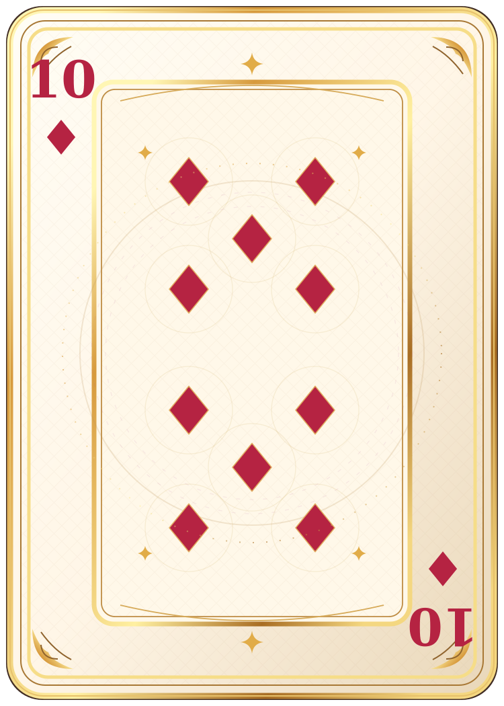
  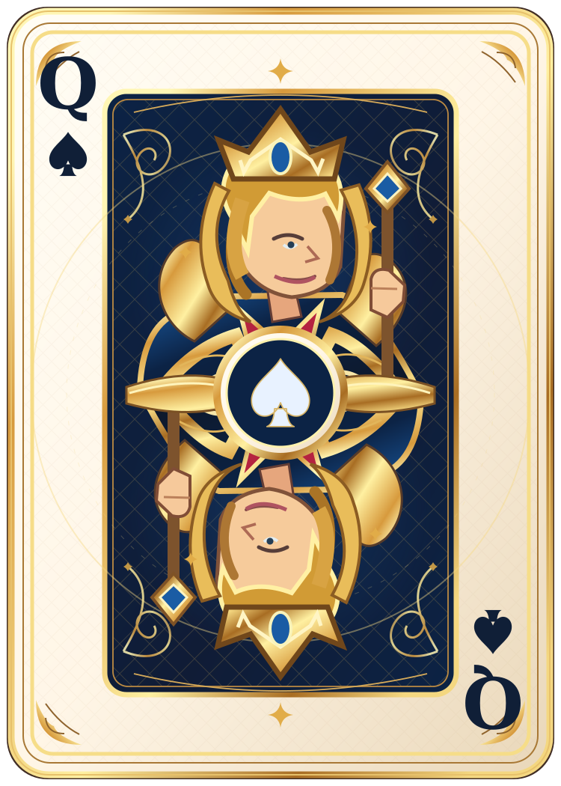
  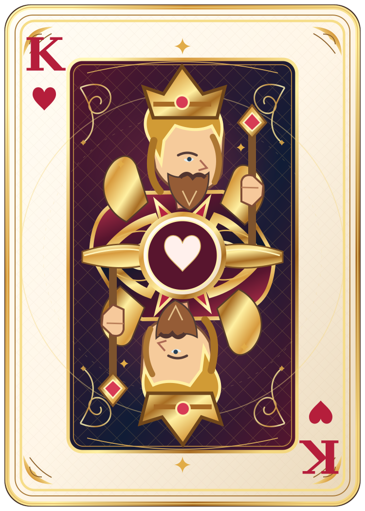
  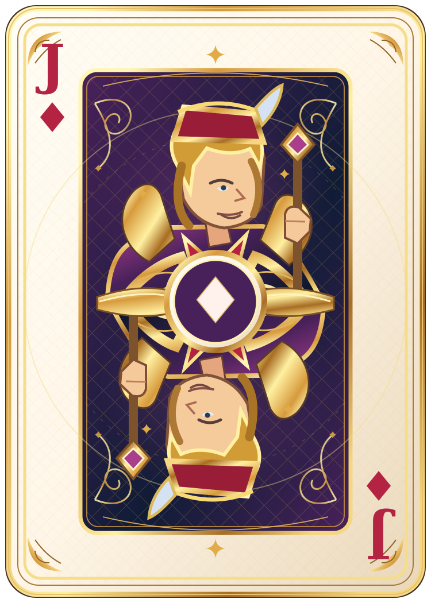
  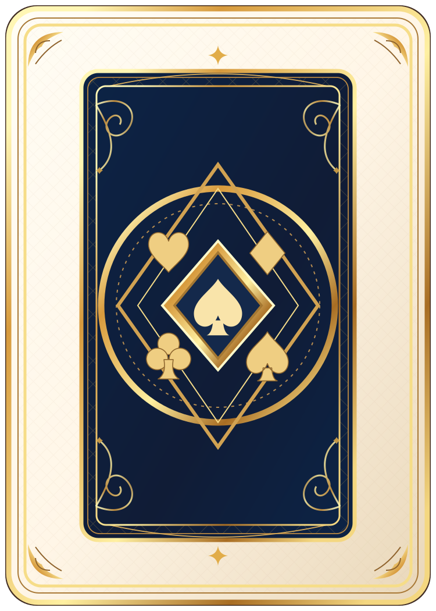

## Cách chơi

1. Mỗi lượt, đánh một lá bài trên tay và đặt chip lên ô có lá tương ứng trên bàn. Mỗi lá (trừ J) có 2 ô trên bàn.
2. 5 chip liền nhau theo hàng ngang, dọc hoặc chéo tạo thành một **dãy**. **Có 2 dãy là thắng.** Dãy thứ hai được dùng chung một chip với dãy đầu.
3. 4 góc là ô tự do, tính cho cả hai người.
4. **J tự do** (J♦ J♣) đặt được vào bất kỳ ô trống nào. **J gỡ** (J♠ J♥) gỡ một chip của đối thủ, trừ chip nằm trong dãy đã hoàn thành.
5. Nếu cả hai ô của một lá đã có chip, lá đó là lá chết. Đổi lấy lá mới mà không mất lượt.

Bàn cờ giống nhau ở mọi ván, xếp theo chất và hạng, nên bạn sẽ dần thuộc vị trí của từng lá.

## Chơi trên điện thoại

- **iPhone (Safari):** bấm nút Chia sẻ, rồi chọn *Thêm vào MH chính*.
- **Android (Chrome):** mở menu, rồi chọn *Cài đặt ứng dụng*.

Sau đó game mở toàn màn hình từ biểu tượng riêng, và bạn chơi với máy được ở bất cứ đâu, kể cả khi không có mạng.

## Lưu ý

- Mỗi ván dành cho hai người chơi.
- Người tạo phòng giữ ván đấu. Nếu họ đóng game, ván kết thúc. Nếu bạn là người được mời và lỡ tải lại trang, chỉ cần mở lại link cũ để vào lại.
- Chỉ gửi link mời cho người bạn muốn chơi cùng.
- Một số mạng chặn kết nối, như Wi-Fi ở trường học hay công ty, có thể không chơi online được. Chơi với máy thì luôn chơi được.

## Ghi công

- Hình lá bài thiết kế bằng Claude Design.
- Chơi online nhờ [PeerJS](https://peerjs.com).
- Font chữ [Fraunces](https://fonts.google.com/specimen/Fraunces) và [DM Sans](https://fonts.google.com/specimen/DM+Sans).

## Giấy phép

[MIT](LICENSE)
